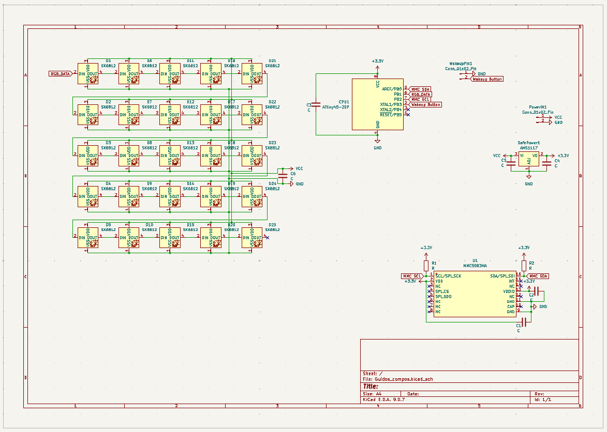
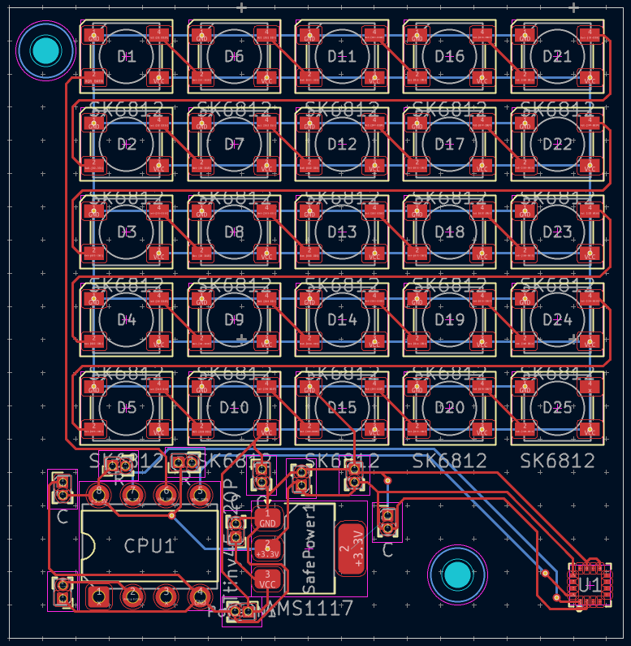
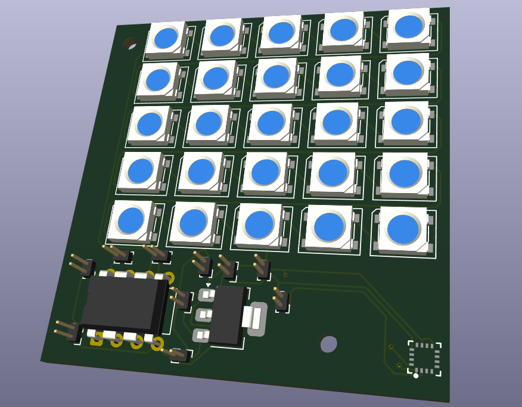

# Guidos_Compos
### - Description:
This is a project I found interesting to do.
It is a simple compas using a MMC5983MA-Magnetometer to detirmine the direction of the earth's magnetic field.
To read the values my "Guidos Compos" is using a bare minimum "ATtiny45-20SU SO-8" as it's cpu.
As for the power source, I am inputing power from a 3.7V 500mAh battery that is beeing lowered down to 3.3V for the "Attiny" and the "Magnetometer". The leds are then powered directly from the battery but beeing controlled from the Attiny.
At some places there are also some capacitors placed out to take in fact of the small noise in the power, which can be an outcome from the battery.
### - Problems along the way:
I have had a few problems along the way, as an example the wiring. I had to redo the entire wiring after noticing that my led lights were rotated incorrectly.
I have also had a little to much going on during this PCB week on [Half Life](https://halflife.hackclub.com/) meaning that I have not had much time to work on my project.
Though, in the end I got something to hopefully work.
### - Firmware:
[firmware.hex](https://github.com/Programmer899/Guidos_Compos/blob/main/firmware.hex)
---
## Schematic:

## PCB

## 3D View

